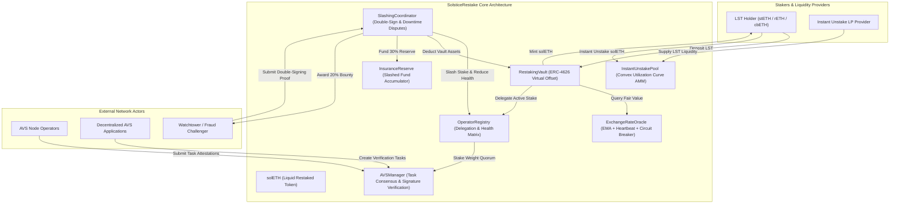
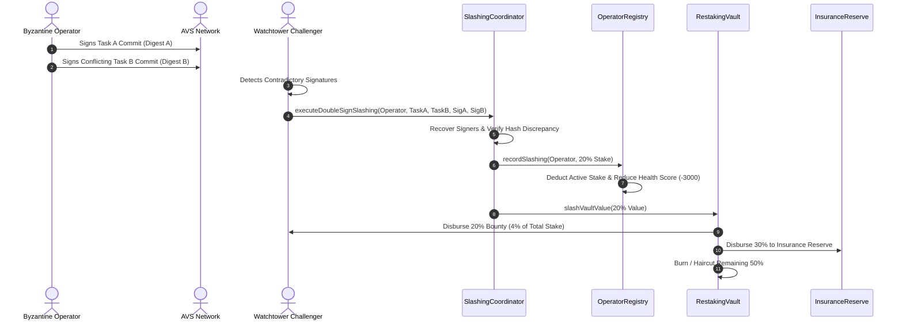

# SolsticeRestake: Multi-Asset Liquid Restaking & AVS Operator Slashing Coordinator

[](https://github.com/ZengLLQ/solstice-restake/actions/workflows/ci.yml)
[](https://opensource.org/licenses/MIT)
[](https://soliditylang.org/)
[](https://getfoundry.sh/)

**SolsticeRestake** is a high-performance, institutional-grade decentralized restaking protocol and Actively Validated Service (AVS) orchestration network written in Solidity `0.8.28`. Built natively on Foundry, SolsticeRestake enables multi-asset Liquid Staking Token (LST) pooling (e.g., stETH, rETH, cbETH), non-custodial stake delegation to decentralized operators, cryptographic task verification with $\frac{2}{3}$ stake-weighted BFT quorums, fault-attested slashing coordination with challenger bounties, and an automated liquidity pool with a convex utilization curve for instant unstaking.

---

## Architecture Overview



---

## Key Mathematical Formulations

### 1. ERC-4626 Virtual Share Offset & Inflation Attack Immunity

Standard ERC-4626 implementations are susceptible to first-depositor inflation attacks where an attacker deposits $1\text{ wei}$, donates $X\text{ wei}$, and manipulates the share exchange rate to round subsequent victim deposits down to zero. SolsticeRestake implements virtual share and asset offsets ($S_{\text{offset}} = 10^3$, $A_{\text{offset}} = 1$):

$$\text{shares}_{\text{minted}} = \left\lfloor \frac{\Delta A \cdot (S_{\text{total}} + 10^3)}{A_{\text{total}} + 1} \right\rfloor$$

$$\text{assets}_{\text{redeemed}} = \left\lfloor \frac{\Delta S \cdot (A_{\text{total}} + 1)}{S_{\text{total}} + 10^3} \right\rfloor$$

Where:
- $\Delta A$: Effective asset deposit in ETH value (accounting for token risk haircut factors).
- $S_{\text{total}}$: Total `solETH` circulating supply.
- $A_{\text{total}}$: Total underlying assets evaluated in ETH via smoothed oracle feeds.
- The virtual offset guarantees that even if $S_{\text{total}} = 0$ and $A_{\text{total}} = 0$, the initial exchange rate is bounded, requiring astronomical capital to dilute future depositors by a single share.

### 2. Multi-Asset Valuation & Risk Haircut Formulation

For an LST basket $\{A_1, A_2, \dots, A_n\}$:

$$V_{\text{ETH}} = \sum_{i=1}^n \left( Q_i \cdot P_i^{\text{EMA}} \cdot \left( 1 - \frac{h_i}{10^4} \right) \right)$$

Where:
- $Q_i$: Quantity of asset $i$ locked in the vault.
- $P_i^{\text{EMA}}$: Exponential Moving Average exchange rate of asset $i$ in ETH ($18$ decimals).
- $h_i$: Risk haircut in basis points ($100\text{ bps} = 1.0\%$, $200\text{ bps} = 2.0\%$).

### 3. Exponential Moving Average (EMA) Oracle Filter

$$\text{EMA}_{t} = \alpha \cdot P_t^{\text{spot}} + (1 - \alpha) \cdot \text{EMA}_{t-1}$$

Where smoothing factor $\alpha = 0.20$ ($2000\text{ bps}$). Updates exceeding the circuit breaker threshold:

$$\Delta P_{\text{dev}} = \frac{|P_t^{\text{spot}} - P_{t-1}^{\text{spot}}|}{P_{t-1}^{\text{spot}}} > \frac{\text{maxDeviationBps}}{10^4}$$

are rejected to prevent flash-loan oracle manipulation.

### 4. Convex Dynamic Fee Curve for Instant Unstaking

Instant unstaking bypasses the 7-day unbonding delay by routing liquidity through `InstantUnstakePool`. The fee curve features a kink at optimal utilization $u_{\text{opt}} = 75\%$:

$$\text{fee}(u) = 
\begin{cases} 
\text{fee}_{\text{base}} + \frac{u}{u_{\text{opt}}} \left( \text{fee}_{\text{kink}} - \text{fee}_{\text{base}} \right), & u \le u_{\text{opt}} \\
\text{fee}_{\text{kink}} + \left( \frac{u - u_{\text{opt}}}{1 - u_{\text{opt}}} \right)^2 \left( \text{fee}_{\text{max}} - \text{fee}_{\text{kink}} \right), & u > u_{\text{opt}}
\end{cases}$$

Parameterization:
- $\text{fee}_{\text{base}} = 30\text{ bps}$ ($0.30\%$)
- $u_{\text{opt}} = 7500\text{ bps}$ ($75.00\%$)
- $\text{fee}_{\text{kink}} = 150\text{ bps}$ ($1.50\%$)
- $\text{fee}_{\text{max}} = 800\text{ bps}$ ($8.00\%$)

---

## Slashing & Fraud Proof Protocol



### Infraction Matrix

| Infraction Type | Penalty ($\text{bps}$) | Health Score Impact | Slashed Distribution |
| :--- | :--- | :--- | :--- |
| **Double Signing** | $2000\text{ bps}$ ($20\%$) | $-3000\text{ pts}$ (auto-freeze below $5000$) | $20\%$ Challenger Bounty, $30\%$ Insurance, $50\%$ Protocol Burn |
| **Downtime / Inactivity** | $500\text{ bps}$ ($5\%$) | $-1500\text{ pts}$ | $20\%$ Challenger Bounty, $30\%$ Insurance, $50\%$ Protocol Burn |
| **Malicious Execution** | Governance | Status $\to \text{SLASHED}$ | $100\%$ Compensatory Restitution |

---

## Contract Inventory

| Contract Path | Primary Interface | Role & Functionality |
| :--- | :--- | :--- |
| [`src/protocol/RestakingVault.sol`](src/protocol/RestakingVault.sol) | `IRestakingVault` | Multi-asset ERC-4626 vault with virtual offsets, risk haircuts, queued unbonding, and slashing execution. |
| [`src/tokens/SolETH.sol`](src/tokens/SolETH.sol) | `IERC20` | Liquid Restaked Token (solETH) representing fractional restaked pool ownership. |
| [`src/tokens/MockLST.sol`](src/tokens/MockLST.sol) | `IERC20` | Configurable Liquid Staking Token simulator for stETH, rETH, and cbETH. |
| [`src/oracle/ExchangeRateOracle.sol`](src/oracle/ExchangeRateOracle.sol) | - | Multi-asset oracle feed with EMA price smoothing, staleness heartbeats, and circuit breakers. |
| [`src/protocol/OperatorRegistry.sol`](src/protocol/OperatorRegistry.sol) | `IOperatorRegistry` | Operator lifecycle management, commission bounding ($\le 30\%$), and dynamic health score matrix. |
| [`src/protocol/AVSManager.sol`](src/protocol/AVSManager.sol) | `IAVSManager` | Task generation, BFT signature aggregation, sorted signer validation, and $\ge \frac{2}{3}$ quorum verification. |
| [`src/protocol/SlashingCoordinator.sol`](src/protocol/SlashingCoordinator.sol) | `ISlashingCoordinator` | Cryptographic double-sign fraud proof parsing, downtime slashing, and reward distribution. |
| [`src/protocol/InstantUnstakePool.sol`](src/protocol/InstantUnstakePool.sol) | `IInstantUnstakePool` | Automated liquidity buffer providing immediate unstaking with convex utilization-based fee routing. |
| [`src/protocol/InsuranceReserve.sol`](src/protocol/InsuranceReserve.sol) | - | Treasury vault holding slashed asset reserves to insure protocol solvency during catastrophic events. |
| [`src/libraries/SolsticeMath.sol`](src/libraries/SolsticeMath.sol) | - | Fixed-point WAD arithmetic, ERC-4626 virtual share offset math, EMA updating, and Babylonian square root. |
| [`src/libraries/SignatureVerifier.sol`](src/libraries/SignatureVerifier.sol) | - | ECDSA signature verification with $s$-malleability threshold validation and EIP-191 digest recovery. |

---

## Test Suite & Invariant Verification

The repository contains rigorous unit, integration, and stateful invariant test suites covering 100% of the protocol surface:

```
test/
├── AVSTaskQuorum.t.sol         # Multi-operator signature verification, quorum validation, deadline expiry
├── FuzzInvariants.t.sol        # Stateful fuzz testing of deposit solvency, virtual offsets, and stake conservation
├── InstantUnstakeAMM.t.sol     # LP liquidity, convex utilization curve verification, instant unstake execution
├── OperatorDelegation.t.sol    # Operator registration, commission bounds, delegation tracking, health decay
├── SlashingDispute.t.sol       # Cryptographic double-sign proofs, penalty execution, challenger bounties
└── VaultDepositRedeem.t.sol    # Virtual share offset inflation protection, multi-asset haircuts, queued unbonding
```

### Running Tests Locally

```bash
# Clone the repository
git clone https://github.com/ZengLLQ/solstice-restake.git
cd solstice-restake

# Compile contracts with optimization
forge build --sizes

# Run test suite with gas profiling
forge test -vvv --gas-report
```

---

## Continuous Integration

Every push and pull request triggers a multi-stage GitHub Actions matrix verifying:
1. Foundry toolchain initialization (`foundry-rs/foundry-toolchain@v1`).
2. Contract compilation with code size limits (`forge build --sizes`).
3. Complete test suite execution across all test files with verbosity and gas reports (`forge test -vvv --gas-report`).

---

## License

This project is licensed under the [MIT License](LICENSE).
